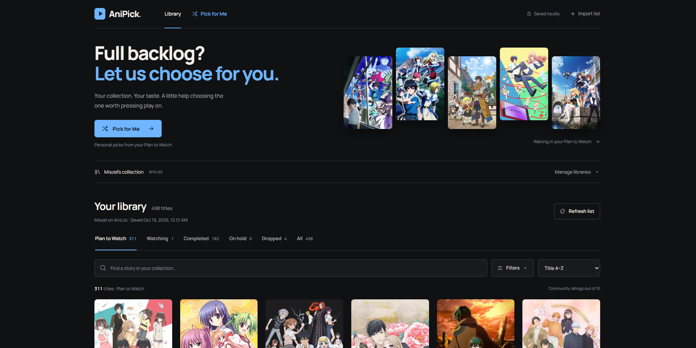
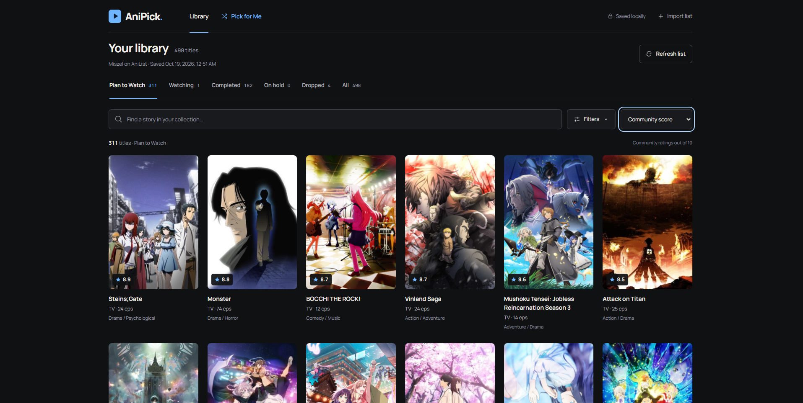
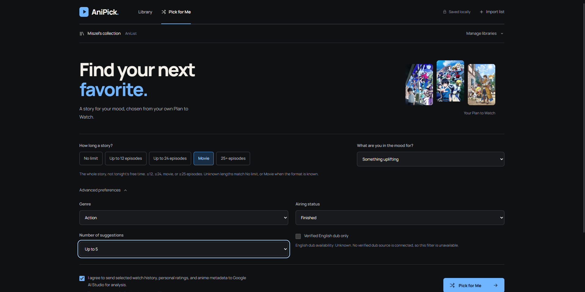

# AniPick

### Full backlog? Let us choose for you.

AniPick helps you choose your next anime from your own **Plan to Watch** list.
Import a public AniList or MyAnimeList watchlist, browse your backlog, then pick a
length and mood. An open-weight AI analyzes your watch history and personal ratings
to suggest titles from your list, with explanations grounded in that history.

Built from scratch for Hacktoberfest 2026 Week 2. **Localhost-first:** your library
stays on your machine, while imports, artwork, cloud AI, and media use online services.

[Quick Start](#quick-start) · [Import a list](#watchlist-imports) · [AI setup](#ai-configuration) · [Documentation](#documentation)

## See AniPick



<details>
<summary>More screenshots: Library and Pick for Me</summary>

**Browse your backlog**



**Choose a length and mood**



</details>

**Presentation video: pending.** A recording link will be added here when available.
The screenshots show the application and recommendation controls, not a generated result.

## Key features

- **Real watchlists:** AniList and MAL username imports, pagination, all list statuses,
  personal ratings, saved-library switching, and refresh with progress and retry controls.
- **A useful backlog browser:** artwork, title search, sorting, genre and length filters,
  detailed anime information, and durable SQLite storage. Browsing needs no AI key.
- **Personalized picks:** model-generated taste profiles and candidate rankings, history
  citations, qualitative confidence, and visible sample coverage. No fake AI fallback.
- **Filters the model must respect:** Plan to Watch only; No limit, ≤12 episodes,
  ≤24 episodes, Movie, or ≥25 episodes. These describe total anime length, not tonight's free time.
- **Your inference choice:** Google AI Studio or a separately running local model server,
  with validated responses and cached profiles/results.
- **Optional previews:** click-to-load source-listed YouTube trailers, TikTok search,
  and user-saved video links. No video scraping, downloading, rehosting, or autoplay.

## Quick Start

Requires **Node.js 24+** and **pnpm 11+**; the project pins pnpm 11.25.0.
No separate database installation, public domain, or cloud hosting is required.

```sh
git clone https://github.com/Michaello2000/AniPick-Ai.git
cd AniPick-Ai
pnpm install
pnpm dev
```

Open [127.0.0.1:5173](http://127.0.0.1:5173). The API runs on port 3001;
both services bind to loopback. Ctrl+C stops them. AniList imports work immediately.
For optional credentials, copy [.env.example](.env.example) to a new `.env`, add your
settings, and restart. Keep an existing `.env` rather than overwriting it.

To run the production build locally:

```sh
pnpm build
pnpm start
```

Open [127.0.0.1:3001](http://127.0.0.1:3001). See [Setup](docs/SETUP.md)
for Windows/pnpm troubleshooting, configuration, and local data management.

## Watchlist imports

**AniList:** choose AniList, enter a public username, and select **Import list**.
No API key or OAuth login is needed.

**MyAnimeList:** register an application at [MAL API configuration](https://myanimelist.net/apiconfig).
In AniPick's import screen, choose MyAnimeList, paste the application's **Client ID**,
and select **Save and enable MAL**. Alternatively, set `MAL_CLIENT_ID` in `.env`
and restart. Viewers need no OAuth login; client secrets and access tokens are unused.

MAL lists use the official v2 API; Jikan supplies optional detail/trailer metadata.
Personal ratings stay separate from community scores, and unscored titles remain **Unrated**.
See [import setup and behavior](docs/SETUP.md#importing-real-lists).

## AI configuration

**Cloud:** obtain a [Google AI Studio key](https://aistudio.google.com/apikey), then add:

```dotenv
GEMINI_API_KEY=your_key_here
AI_PROVIDER=google
AI_MODEL=gemma-4-26b-a4b-it
```

Restart, open **Pick for Me**, choose length/mood, and consent before generating.
Cloud mode sends a bounded sample of history, ratings, and candidate metadata to Google.
Access and quotas depend on your account. Keep keys server-only in `.env`, never
in `VITE_*`, URLs, screenshots, or Git. See [Recommendations](docs/RECOMMENDATIONS.md).

**Local (optional):** start a compatible model server separately, then choose **Local**
in AI settings, refresh models, and select its exact model ID. Bonsai 2 via PrismML's
llama.cpp runtime, Ollama, and LM Studio have configuration guidance in [Local AI](docs/LOCAL_AI.md).
AniPick does not install weights or launch the server. Local mode needs no Google key
and never falls back to cloud. **Live local-model inference remains unverified.**

Open weights let you replace the inference runtime while keeping your library and app
rules. Cloud avoids local hardware requirements; local inference uses your hardware.
The application as a whole is **not fully offline** in either mode.

## Technology stack

React 19, TypeScript, Vite, and Tailwind CSS; a local Express API with Node's built-in
SQLite, Zod validation, and native HTTP inference adapters. Vitest, ESLint, and TypeScript
provide automated checks. Dependencies are locked with `pnpm-lock.yaml`.

## Known limitations

- Recommendations use bounded samples. Sparse ratings and incomplete metadata reduce
  personalization; natural-language explanations can be mistaken or reveal spoilers.
- MAL live-import verification was skipped in the recorded audit; Jikan requests failed.
  Earlier cloud generation succeeded, but a later key check failed. See [Testing](docs/TESTING.md).
- No automated verified-dub or streaming-availability source exists; unknown stays unknown.
  External account writes and public hosting are outside the implemented scope.
- Third-party player restrictions can block videos. Successful-result screenshots,
  mobile captures, and a full playback review remain outstanding.

## Documentation

- [Setup](docs/SETUP.md): installation, MAL credentials, environment variables, and storage.
- [Local AI](docs/LOCAL_AI.md): Bonsai 2, runtimes, Windows setup, sampling, and compatibility.
- [Recommendations](docs/RECOMMENDATIONS.md): selection, validation, caching, and privacy.
- [Media](docs/MEDIA.md): trailers, TikTok links, embeds, and provider restrictions.
- [Testing](docs/TESTING.md): commands, dated results, live audit, and demo walkthrough.
- [Design](DESIGN.md), [Product](PRODUCT.md), [AI behavior contract](docs/ANIPICK_AI_SYSTEM_PROMPT.md), and [Agent instructions](AGENTS.md).

## License and credits

[MIT License](LICENSE). Watchlist/anime data: AniList, MyAnimeList, and Jikan.
Cloud inference: Google AI Studio and Google DeepMind's Gemma. Optional local runtime:
PrismML's Bonsai-demo and compatible model hosts. Model/runtime licenses apply separately.

Manrope by the Manrope Project Authors is bundled under the [SIL Open Font License](public/fonts/OFL-Manrope.txt).
Provider SVG marks come from [Simple Icons](https://github.com/simple-icons/simple-icons)
under [CC0](https://github.com/simple-icons/simple-icons/blob/develop/LICENSE.md).
Posters, synopses, videos, and trademarks belong to their respective owners. YouTube and
TikTok provide the embedded players; provider terms apply. Source-listed trailers do
not prove rights-holder authenticity. AniPick is not affiliated with these services.
